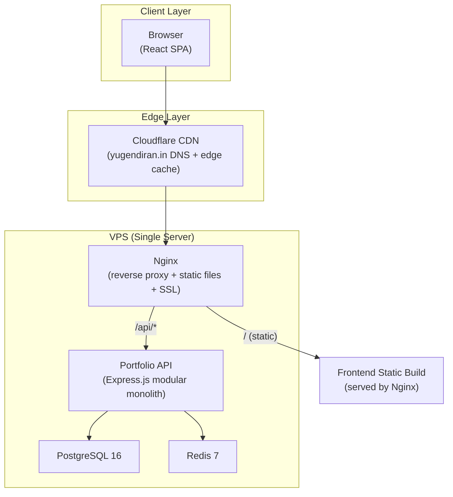
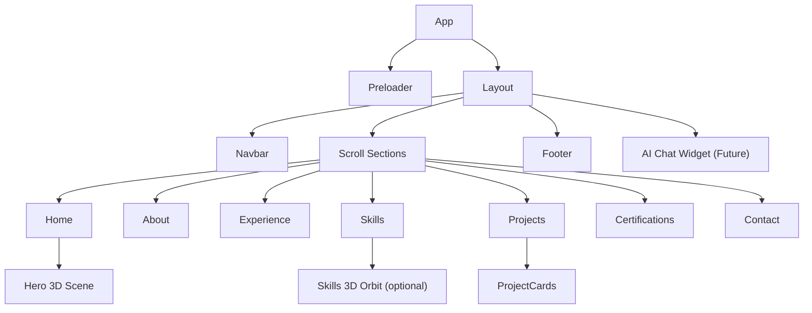
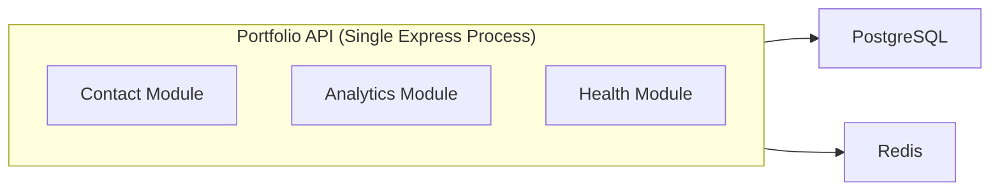
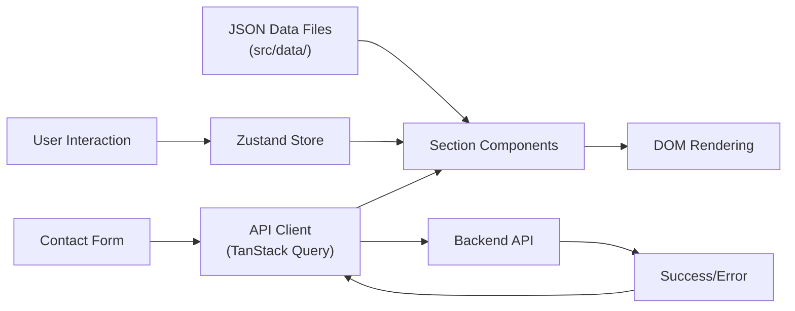
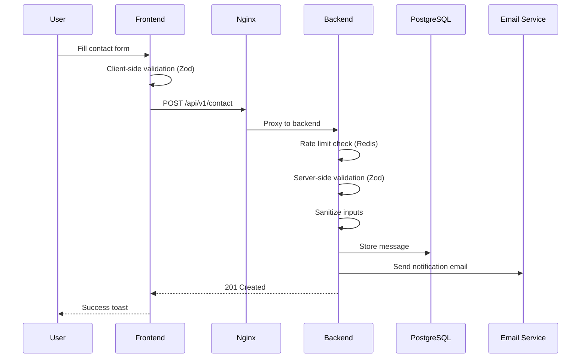
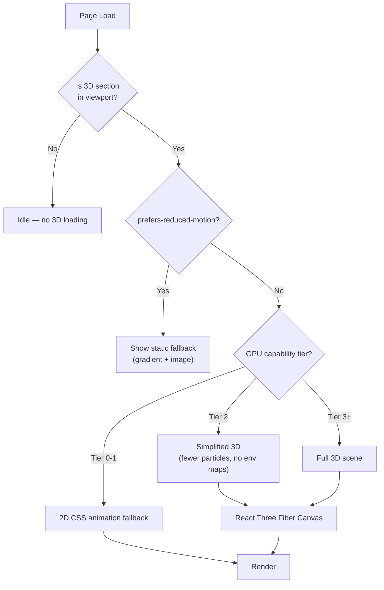
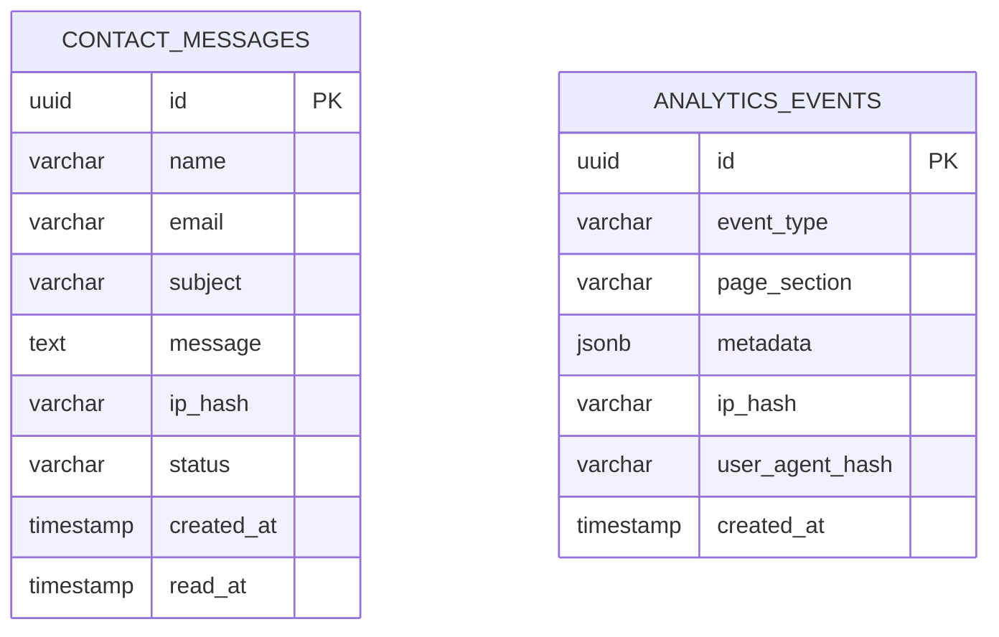
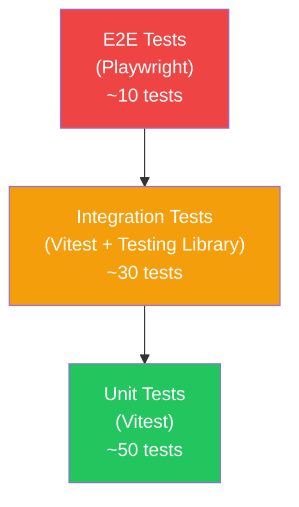
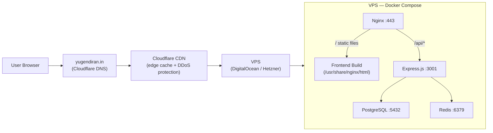
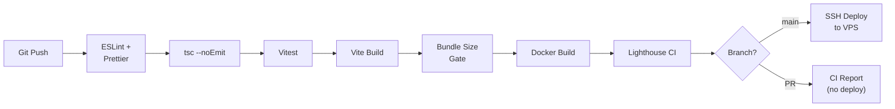

# Yugendiran 3D Portfolio — System Architecture (Revised)

> **Status:** Awaiting final approval before implementation  
> **Revision:** 2 — incorporates all 10 architecture-level corrections  
> **Author:** Senior Software Architect  
> **Date:** 2026-09-27

---

## Table of Contents

1. [Complete System Architecture](#1-complete-system-architecture)
2. [Frontend Architecture](#2-frontend-architecture)
3. [Backend Architecture](#3-backend-architecture)
4. [Microservice Boundaries](#4-microservice-boundaries)
5. [Recommended Technology Stack](#5-recommended-technology-stack)
6. [Folder Structure](#6-folder-structure)
7. [Data Flow](#7-data-flow)
8. [API Structure](#8-api-structure)
9. [Database Strategy](#9-database-strategy)
10. [3D Rendering Strategy](#10-3d-rendering-strategy)
11. [Performance Strategy](#11-performance-strategy)
12. [Security Strategy](#12-security-strategy)
13. [SEO Strategy](#13-seo-strategy)
14. [Testing Strategy](#14-testing-strategy)
15. [Deployment Architecture](#15-deployment-architecture)
16. [Time & Space Complexity Decisions](#16-time--space-complexity-decisions)
17. [Architecture Decision Records](#17-architecture-decision-records)

---

## Revision Changelog

| #   | Correction                          | What Changed                                                                                                                                                                                                    |
| --- | ----------------------------------- | --------------------------------------------------------------------------------------------------------------------------------------------------------------------------------------------------------------- |
| 1   | Modular monolith for V1             | Removed language suggesting microservice extraction is planned. AI assistant is a _possible_ future extraction, not a scheduled one.                                                                            |
| 2   | R3F frameloop strategy              | Split into `demand` (static/interaction-driven scenes) and controlled `always` (continuously animated Hero). No blanket claim of `demand` for animated scenes.                                                  |
| 3   | Remove global `<Preload all />`     | Replaced with selective `useGLTF.preload()` / `useTexture.preload()` for Hero-critical assets only. Non-critical 3D assets remain lazy.                                                                         |
| 4   | Core Web Vitals                     | Replaced `FID/INP` with `INP` as the primary interaction metric. FID removed.                                                                                                                                   |
| 5   | Bundle sizes as CI budgets          | Reframed all size numbers as CI-enforced regression gates, not guaranteed package sizes. Added `bundlesize` CI step.                                                                                            |
| 6   | Simplified deployment               | Removed Vercel/Railway dual-path. Single production path: `yugendiran.in → Cloudflare → VPS (Nginx → Frontend/Backend → PostgreSQL/Redis)`.                                                                     |
| 7   | Redis scoped usage                  | Explicitly limited Redis to: rate limiting, analytics aggregation cache. Removed vague "session cache" and "response cache" references.                                                                         |
| 8   | All original requirements preserved | Confirmed: white theme, blue/purple accents, glassmorphism, real 3D, responsive, data-driven, Docker, PostgreSQL, Redis, testing, CI/CD, security, SEO, a11y, performance, future AI, easy updates, clean code. |
| 9   | Practical DSA decisions             | Removed language about hash maps and search indices. All complexity decisions grounded in actual portfolio data sizes.                                                                                          |
| 10  | ADR section added                   | New §17 with full Architecture Decision Records.                                                                                                                                                                |

---

## 1. Complete System Architecture



### Architectural Principles

| Principle            | Decision                          | Rationale                                                                                         |
| -------------------- | --------------------------------- | ------------------------------------------------------------------------------------------------- |
| **Monorepo**         | Yes — single repo, npm workspaces | Simpler CI/CD, shared types, atomic commits                                                       |
| **SSR vs SPA**       | SPA with prerendering for SEO     | A portfolio is read-heavy and visually rich; prerendering gives SEO without SSR server costs      |
| **Architecture**     | Modular monolith for V1           | Portfolio does not have the traffic or domain complexity to justify a distributed system (see §4) |
| **API style**        | REST with JSON                    | Simple, cacheable, universally understood                                                         |
| **State management** | Zustand (lightweight)             | Portfolio state is small and shallow; no Redux boilerplate needed                                 |
| **3D approach**      | React Three Fiber (R3F)           | Declarative Three.js inside React; tree-shakes unused Three.js modules                            |

---

## 2. Frontend Architecture

### 2.1 High-Level Component Tree



### 2.2 Architecture Layers

```
┌─────────────────────────────────────────────────────┐
│  Presentation Layer                                 │
│  Components, Layouts, 3D Scenes                     │
├─────────────────────────────────────────────────────┤
│  State Layer                                        │
│  Zustand stores, React Context (theme, nav state)   │
├─────────────────────────────────────────────────────┤
│  Data Layer                                         │
│  Content JSON files, API client (TanStack Query)    │
├─────────────────────────────────────────────────────┤
│  Infrastructure Layer                               │
│  Analytics, Error Boundary, Accessibility hooks      │
└─────────────────────────────────────────────────────┘
```

### 2.3 Content-Data Separation

> [!IMPORTANT]
> All portfolio content (bio, experience entries, project descriptions, skills, certifications) lives in **structured JSON data files** under `src/data/`. UI components never contain hardcoded content. This enables easy updates without touching component code.

```
src/data/
  profile.json        # Name, title, bio, social links
  experience.json     # Work history entries
  skills.json         # Skill categories and items
  projects.json       # Project cards data
  certifications.json # Certification entries
  navigation.json     # Nav items and section metadata
```

### 2.4 Routing Strategy

Single-page scroll-based navigation with hash anchors (`#about`, `#projects`, etc.) rather than multi-page routing. This is the natural UX for a portfolio:

- **Intersection Observer** tracks which section is in view → updates active nav item
- **Smooth scroll** with `scroll-behavior: smooth` and JS fallback
- **Deep-linkable** via hash URLs (`yugendiran.in/#contact`)

No React Router needed for V1. If a blog or multi-page feature is added later, React Router can be introduced without refactoring.

### 2.5 Design System

| Token                   | Value                              | Usage                     |
| ----------------------- | ---------------------------------- | ------------------------- |
| `--color-bg`            | `#FAFBFF`                          | Page background           |
| `--color-surface`       | `#FFFFFF`                          | Card surfaces             |
| `--color-glass`         | `rgba(255,255,255,0.6)`            | Glassmorphism panels      |
| `--color-accent-blue`   | `#3B82F6` → `#2563EB`              | Primary accent gradient   |
| `--color-accent-purple` | `#8B5CF6` → `#7C3AED`              | Secondary accent gradient |
| `--color-text`          | `#1E293B`                          | Body text                 |
| `--color-text-muted`    | `#64748B`                          | Secondary text            |
| `--font-heading`        | `'Inter', sans-serif`              | Headings                  |
| `--font-body`           | `'Inter', sans-serif`              | Body text                 |
| `--font-mono`           | `'JetBrains Mono', monospace`      | Code / tech accents       |
| `--radius-sm`           | `8px`                              | Small elements            |
| `--radius-md`           | `16px`                             | Cards                     |
| `--radius-lg`           | `24px`                             | Large panels              |
| `--shadow-glass`        | `0 8px 32px rgba(59,130,246,0.08)` | Glassmorphism shadow      |
| `--blur-glass`          | `blur(12px)`                       | Glass backdrop            |

### 2.6 Responsive Breakpoints

| Breakpoint    | Name | Target         |
| ------------- | ---- | -------------- |
| `< 480px`     | `xs` | Small phones   |
| `480–768px`   | `sm` | Large phones   |
| `768–1024px`  | `md` | Tablets        |
| `1024–1440px` | `lg` | Laptops        |
| `> 1440px`    | `xl` | Large displays |

Mobile-first CSS: base styles target `xs`, then `min-width` media queries scale up.

### 2.7 Animation Strategy

- **Framer Motion** for layout and scroll-triggered animations (fade-in, slide-up)
- **React Three Fiber** for 3D animations (runs on GPU, separate from DOM)
- **`prefers-reduced-motion`** media query: all animations disabled or reduced to opacity-only transitions
- **No GSAP** — Framer Motion covers all needs without the extra bundle weight

---

## 3. Backend Architecture

### 3.1 Overview

The backend is a lightweight **Express.js modular monolith** serving:

1. **Contact form submission** (email forwarding + DB storage)
2. **Analytics events** (privacy-respecting page view tracking)
3. **Health checks** (for Docker and monitoring)

It does **not** serve the frontend (Nginx serves static files directly).

### 3.2 Backend Layers

```
┌──────────────────────────────────────┐
│  Route Layer (Express Router)        │
├──────────────────────────────────────┤
│  Controller Layer (Request/Response) │
├──────────────────────────────────────┤
│  Service Layer (Business Logic)      │
├──────────────────────────────────────┤
│  Repository Layer (Data Access)      │
├──────────────────────────────────────┤
│  Infrastructure (DB, Cache, Email)   │
└──────────────────────────────────────┘
```

### 3.3 API Server Details

| Aspect        | Decision                                |
| ------------- | --------------------------------------- |
| Runtime       | Node.js 20 LTS                          |
| Framework     | Express.js 5                            |
| Language      | TypeScript (shared types with frontend) |
| Validation    | Zod schemas                             |
| ORM           | Drizzle ORM (lightweight, type-safe)    |
| Rate limiting | express-rate-limit + Redis store        |
| Email         | Nodemailer (SMTP) or Resend API         |
| Logging       | Pino (structured JSON logs)             |

---

## 4. Microservice Boundaries

### V1: Modular Monolith — No Microservices

> [!NOTE]
> A portfolio website does **not** justify a microservice architecture. Forcing microservices here would add network latency, deployment complexity, and operational overhead with zero benefit.
>
> V1 is a **modular monolith** — a single Express.js process with clearly separated internal modules. Each module has its own routes, controllers, services, and repositories. Modules share the same database connection pool and Express instance but maintain **zero cross-module imports**.



### Internal Module Boundaries

| Module      | Responsibility                                                  | Cross-module imports |
| ----------- | --------------------------------------------------------------- | -------------------- |
| `contact`   | Form validation, spam filtering, email dispatch, DB persistence | None                 |
| `analytics` | Page view tracking, event collection (privacy-respecting)       | None                 |
| `health`    | Liveness and readiness probes                                   | None                 |

### Future Considerations

| Possible Future Module    | Where It Lives                | Extraction Criteria                                                                                                                                                                                                          |
| ------------------------- | ----------------------------- | ---------------------------------------------------------------------------------------------------------------------------------------------------------------------------------------------------------------------------- |
| `content` (CMS-like CRUD) | Inside the monolith           | Only extract if it needs independent scaling                                                                                                                                                                                 |
| `ai` (AI assistant)       | Inside the monolith initially | _May_ be extracted to a separate service if it requires a different runtime (Python), GPU resources, or independent scaling. This is not a planned extraction — it depends on actual requirements when the feature is built. |

> [!TIP]
> The modular monolith structure makes future extraction straightforward: a module's route file becomes its own Express app, its service/repository files move to a new package, and the shared database can be split if needed. The zero-cross-import discipline ensures no hidden coupling.

---

## 5. Recommended Technology Stack

### Frontend

| Category      | Technology                               | Rationale                                                         |
| ------------- | ---------------------------------------- | ----------------------------------------------------------------- |
| Framework     | **React 19**                             | Industry standard, massive ecosystem, excellent 3D integration    |
| Build tool    | **Vite 6**                               | Fast HMR, native ESM, excellent tree-shaking                      |
| Language      | **TypeScript 5.5**                       | Type safety, shared types with backend                            |
| 3D            | **React Three Fiber + Drei**             | Declarative Three.js, tree-shakeable, React lifecycle integration |
| Animation     | **Framer Motion 12**                     | Declarative animations, scroll-triggered, layout animations       |
| State         | **Zustand**                              | ~1KB, no boilerplate, no providers needed                         |
| Data fetching | **TanStack Query**                       | Caching, deduplication, background refetch for API calls          |
| Styling       | **Vanilla CSS + CSS Modules**            | Zero runtime overhead, scoped styles, no extra dependencies       |
| Fonts         | **Google Fonts (Inter, JetBrains Mono)** | Professional, high-quality, free                                  |
| Icons         | **Lucide React**                         | Tree-shakeable, consistent, lightweight                           |
| Prerendering  | **vite-plugin-prerender**                | Static HTML for SEO without SSR server                            |

### Backend

| Category   | Technology         | Rationale                                 |
| ---------- | ------------------ | ----------------------------------------- |
| Runtime    | **Node.js 20 LTS** | Same language as frontend, shared types   |
| Framework  | **Express.js 5**   | Mature, minimal, well-understood          |
| Language   | **TypeScript 5.5** | Shared types with frontend                |
| ORM        | **Drizzle ORM**    | Type-safe, SQL-like, minimal overhead     |
| Validation | **Zod**            | Runtime validation + TypeScript inference |
| Email      | **Resend**         | Modern email API, simple, reliable        |
| Logging    | **Pino**           | Fastest Node.js logger, structured JSON   |

### Infrastructure

| Category           | Technology                        | Rationale                                              |
| ------------------ | --------------------------------- | ------------------------------------------------------ |
| Database           | **PostgreSQL 16**                 | Robust, free, JSONB for flexible content               |
| Cache / Rate Store | **Redis 7**                       | Rate limiting store + analytics aggregation cache      |
| Reverse proxy      | **Nginx**                         | Static file serving, SSL termination, API proxying     |
| CDN / DNS          | **Cloudflare** (free tier)        | Edge caching, DDoS protection, DNS for yugendiran.in   |
| Containers         | **Docker + Docker Compose**       | Reproducible environments, single-command deployment   |
| CI/CD              | **GitHub Actions**                | Free for public repos, excellent Docker support        |
| Hosting            | **VPS (DigitalOcean or Hetzner)** | Cost-effective, full control, single deployment target |

### Bundle Size CI Budgets

> [!IMPORTANT]
> These are **CI-enforced regression limits**, not guaranteed package sizes. Actual sizes will be measured at build time via `rollup-plugin-visualizer` and enforced by a `bundlesize` check in the CI pipeline. If a build exceeds these limits, the CI job fails and must be investigated.

| Budget Gate                                                        | Max Gzipped | Load Strategy                                      |
| ------------------------------------------------------------------ | ----------- | -------------------------------------------------- |
| **Critical path chunk** (React, Framer Motion, Zustand, app shell) | **≤ 85KB**  | Immediate                                          |
| **3D chunk** (Three.js tree-shaken via R3F + Drei)                 | **≤ 100KB** | Lazy — loaded when Hero enters viewport            |
| **Contact/API chunk** (TanStack Query + Zod client)                | **≤ 20KB**  | Lazy — loaded when Contact section enters viewport |
| **Total all chunks combined**                                      | **≤ 220KB** | —                                                  |

These budgets will be baselined after the first production build and then tracked for regressions. The exact numbers may shift during initial development; what matters is that they are **measured and enforced**, not assumed.

---

## 6. Folder Structure

```
yugendiran-3d-portfolio/
├── .github/
│   └── workflows/
│       ├── ci.yml                    # Lint, typecheck, test, build, bundle budget
│       └── deploy.yml                # Docker build + deploy to VPS
│
├── packages/
│   └── shared/                       # Shared TypeScript types
│       ├── src/
│       │   └── types/
│       │       ├── contact.ts        # Contact form types
│       │       ├── profile.ts        # Profile data types
│       │       └── index.ts
│       ├── package.json
│       └── tsconfig.json
│
├── frontend/
│   ├── public/
│   │   ├── fonts/                    # Self-hosted Inter, JetBrains Mono
│   │   ├── models/                   # Compressed .glb 3D models (if any)
│   │   ├── images/                   # Optimized images (WebP + AVIF)
│   │   ├── favicon.ico
│   │   ├── robots.txt
│   │   └── sitemap.xml
│   │
│   ├── src/
│   │   ├── assets/                   # SVGs, static assets imported by components
│   │   │
│   │   ├── components/
│   │   │   ├── common/               # Reusable UI primitives
│   │   │   │   ├── Button/
│   │   │   │   │   ├── Button.tsx
│   │   │   │   │   ├── Button.module.css
│   │   │   │   │   └── index.ts
│   │   │   │   ├── Card/
│   │   │   │   ├── SectionHeading/
│   │   │   │   ├── GlassPanel/
│   │   │   │   └── SkeletonLoader/
│   │   │   │
│   │   │   ├── layout/               # Structural components
│   │   │   │   ├── Navbar/
│   │   │   │   ├── Footer/
│   │   │   │   └── ScrollProgress/
│   │   │   │
│   │   │   ├── three/                # 3D scene components (entirely lazy-loadable)
│   │   │   │   ├── HeroScene/
│   │   │   │   │   ├── HeroScene.tsx
│   │   │   │   │   ├── FloatingGeometry.tsx
│   │   │   │   │   ├── ParticleField.tsx
│   │   │   │   │   └── index.ts
│   │   │   │   ├── SceneContainer.tsx  # Shared Canvas wrapper with per-scene config
│   │   │   │   └── FallbackPlaceholder.tsx
│   │   │   │
│   │   │   └── sections/             # Page sections
│   │   │       ├── Preloader/
│   │   │       ├── Hero/
│   │   │       ├── About/
│   │   │       ├── Experience/
│   │   │       ├── Skills/
│   │   │       ├── Projects/
│   │   │       ├── Certifications/
│   │   │       └── Contact/
│   │   │
│   │   ├── data/                     # Content data (JSON) — edit here to update portfolio
│   │   │   ├── profile.json
│   │   │   ├── experience.json
│   │   │   ├── skills.json
│   │   │   ├── projects.json
│   │   │   ├── certifications.json
│   │   │   └── navigation.json
│   │   │
│   │   ├── hooks/                    # Custom React hooks
│   │   │   ├── useScrollSpy.ts
│   │   │   ├── useMediaQuery.ts
│   │   │   ├── useReducedMotion.ts
│   │   │   └── useIntersection.ts
│   │   │
│   │   ├── stores/                   # Zustand stores
│   │   │   ├── useAppStore.ts
│   │   │   └── usePreloaderStore.ts
│   │   │
│   │   ├── styles/                   # Global styles
│   │   │   ├── reset.css
│   │   │   ├── variables.css         # Design tokens (§2.5)
│   │   │   ├── typography.css
│   │   │   ├── animations.css
│   │   │   └── global.css
│   │   │
│   │   ├── utils/                    # Pure utility functions
│   │   │   ├── cn.ts                 # className merge utility
│   │   │   ├── debounce.ts
│   │   │   ├── throttle.ts
│   │   │   └── format.ts
│   │   │
│   │   ├── services/                 # API client layer
│   │   │   ├── api.ts                # Base fetch wrapper
│   │   │   └── contactService.ts
│   │   │
│   │   ├── App.tsx
│   │   ├── main.tsx
│   │   └── vite-env.d.ts
│   │
│   ├── index.html
│   ├── vite.config.ts
│   ├── tsconfig.json
│   ├── tsconfig.app.json
│   ├── tsconfig.node.json
│   └── package.json
│
├── backend/
│   ├── src/
│   │   ├── modules/
│   │   │   ├── contact/
│   │   │   │   ├── contact.routes.ts
│   │   │   │   ├── contact.controller.ts
│   │   │   │   ├── contact.service.ts
│   │   │   │   ├── contact.repository.ts
│   │   │   │   ├── contact.schema.ts     # Zod validation
│   │   │   │   └── index.ts
│   │   │   │
│   │   │   ├── analytics/
│   │   │   │   ├── analytics.routes.ts
│   │   │   │   ├── analytics.controller.ts
│   │   │   │   ├── analytics.service.ts
│   │   │   │   └── index.ts
│   │   │   │
│   │   │   └── health/
│   │   │       └── health.routes.ts
│   │   │
│   │   ├── middleware/
│   │   │   ├── rateLimiter.ts
│   │   │   ├── cors.ts
│   │   │   ├── helmet.ts
│   │   │   ├── errorHandler.ts
│   │   │   └── requestLogger.ts
│   │   │
│   │   ├── config/
│   │   │   ├── env.ts                    # Validated env vars (Zod)
│   │   │   ├── database.ts
│   │   │   └── redis.ts
│   │   │
│   │   ├── db/
│   │   │   ├── schema.ts                 # Drizzle schema
│   │   │   ├── migrations/
│   │   │   └── seed.ts
│   │   │
│   │   ├── utils/
│   │   │   └── logger.ts                 # Pino instance
│   │   │
│   │   ├── app.ts                        # Express app factory
│   │   └── server.ts                     # Entry point
│   │
│   ├── tsconfig.json
│   ├── package.json
│   └── Dockerfile
│
├── docker/
│   ├── nginx/
│   │   └── nginx.conf
│   └── postgres/
│       └── init.sql
│
├── docker-compose.yml                    # Development
├── docker-compose.prod.yml               # Production
├── package.json                          # Workspace root (npm workspaces)
├── tsconfig.base.json
├── .env.example
├── .gitignore
├── .dockerignore
├── .eslintrc.cjs
├── .prettierrc
└── README.md
```

### Why This Structure?

| Decision                                    | Rationale                                                                                           |
| ------------------------------------------- | --------------------------------------------------------------------------------------------------- |
| `packages/shared/`                          | Single source of truth for TypeScript types shared between frontend and backend                     |
| `src/components/sections/` not `src/pages/` | No pages — this is a single-page scroll site; sections are the logical units                        |
| `src/data/` JSON files                      | Content changes = edit JSON, not components. Non-developers can update content                      |
| `src/components/three/`                     | 3D code is isolated; can be entirely lazy-loaded or removed without affecting the rest              |
| Module-per-feature in backend               | Each feature (`contact`, `analytics`) is self-contained with its own routes/controller/service/repo |
| CSS Modules                                 | Scoped styles without runtime cost; component-level `.module.css` files                             |

---

## 7. Data Flow

### 7.1 Frontend Data Flow



### 7.2 Contact Form Flow



### 7.3 3D Asset Loading Flow



---

## 8. API Structure

### Base URL: `/api/v1`

| Method | Endpoint             | Purpose                      | Auth                         | Rate Limit    |
| ------ | -------------------- | ---------------------------- | ---------------------------- | ------------- |
| `GET`  | `/health`            | Liveness check               | None                         | None          |
| `GET`  | `/health/ready`      | Readiness probe (DB + Redis) | None                         | None          |
| `POST` | `/contact`           | Submit contact message       | None (honeypot + rate limit) | 3/min per IP  |
| `POST` | `/analytics/event`   | Track page view / event      | API key                      | 60/min per IP |
| `GET`  | `/analytics/summary` | Get analytics summary        | Admin token                  | 10/min        |

### Future Endpoints (not implemented in V1)

| Method | Endpoint              | Purpose                      |
| ------ | --------------------- | ---------------------------- |
| `POST` | `/ai/chat`            | Send message to AI assistant |
| `GET`  | `/ai/chat/:sessionId` | Get chat history for session |

### Response Envelope (consistent across all endpoints)

```json
{
  "success": true,
  "data": { ... },
  "error": null,
  "meta": {
    "timestamp": "2026-09-27T18:00:00Z",
    "requestId": "req_abc123"
  }
}
```

### Error Envelope

```json
{
  "success": false,
  "data": null,
  "error": {
    "code": "VALIDATION_ERROR",
    "message": "Invalid email address",
    "details": [{ "field": "email", "message": "Must be a valid email" }]
  },
  "meta": {
    "timestamp": "2026-09-27T18:00:00Z",
    "requestId": "req_abc456"
  }
}
```

---

## 9. Database Strategy

### 9.1 Why PostgreSQL

- Portfolio needs are simple but PostgreSQL handles them perfectly
- JSONB columns provide flexibility for semi-structured content (future CMS)
- Full-text search (future blog/search) without adding Elasticsearch
- Free, robust, excellent Docker support

### 9.2 Schema



> [!NOTE]
> The `ai_chat_sessions` table from the original architecture is **deferred to the future AI feature**. Tables are created only when their features are implemented.

### 9.3 Indexing Strategy

| Table              | Index                      | Type             | Rationale                              |
| ------------------ | -------------------------- | ---------------- | -------------------------------------- |
| `contact_messages` | `created_at`               | B-tree           | Sort by date for admin review          |
| `contact_messages` | `status`                   | B-tree           | Filter unread messages                 |
| `contact_messages` | `ip_hash`                  | B-tree           | Rate limiting lookups                  |
| `analytics_events` | `(event_type, created_at)` | Composite B-tree | Query events by type within date range |
| `analytics_events` | `page_section`             | B-tree           | Per-section analytics                  |

### 9.4 Migration Strategy

- **Drizzle Kit** for schema migrations
- Migrations stored in `backend/src/db/migrations/`
- Applied automatically on container startup (with safety checks)
- Rollback scripts for every migration

### 9.5 Data Retention

| Data             | Retention  | Rationale                   |
| ---------------- | ---------- | --------------------------- |
| Contact messages | Indefinite | Business communications     |
| Analytics events | 90 days    | Privacy, storage efficiency |

---

## 10. 3D Rendering Strategy

### 10.1 Philosophy

> 3D elements must enhance the premium feel, not compete for attention. Every 3D element must justify its GPU cost.

### 10.2 Where to Use 3D

| Section        | 3D Element                                                                                               | Justification                                                                    |
| -------------- | -------------------------------------------------------------------------------------------------------- | -------------------------------------------------------------------------------- |
| **Hero**       | Abstract floating geometry (torus knots, icosahedrons) with slow continuous rotation + ambient particles | Creates the premium first impression; this is where 3D has maximum visual impact |
| **Skills**     | Optional orbital arrangement of skill icons                                                              | Visually differentiating; can be replaced with 2D grid on low-end devices        |
| **Background** | Subtle particle field or mesh gradient (shader-based)                                                    | Adds depth without being distracting                                             |

### 10.3 Where NOT to Use 3D

| Section        | Why Not                                                    |
| -------------- | ---------------------------------------------------------- |
| About          | Text-heavy section; 3D would distract from content         |
| Experience     | Timeline format; 3D adds no value                          |
| Projects       | Card grid; images/screenshots are more informative than 3D |
| Certifications | Simple list; no visual benefit from 3D                     |
| Contact        | Form interaction; 3D would be distracting                  |

### 10.4 Rendering Mode Strategy

> [!IMPORTANT]
> **Corrected from V1 architecture:** The frameloop mode is chosen per-scene based on the scene's actual rendering needs, not applied as a blanket setting.

| Scene                                              | Frameloop Mode                                                | Rationale                                                                                                                                                                                                                                         |
| -------------------------------------------------- | ------------------------------------------------------------- | ------------------------------------------------------------------------------------------------------------------------------------------------------------------------------------------------------------------------------------------------- |
| **Hero Scene** (floating geometry, particle field) | `frameloop="always"` with **controlled continuous rendering** | Geometry continuously rotates and particles continuously animate. This scene genuinely requires per-frame updates. Performance is managed through GPU tier detection, adaptive DPR, and instanced meshes — not by pretending the scene is static. |
| **Skills Orbit** (if implemented)                  | `frameloop="demand"` with `invalidate()` on interaction       | Skill icons only need to re-render when the user interacts (hover, drag). No continuous animation when idle.                                                                                                                                      |
| **Any future interaction-driven 3D**               | `frameloop="demand"`                                          | Static or user-triggered scenes should not burn GPU frames when nothing is changing.                                                                                                                                                              |

### 10.5 Technical Approach

```
React Three Fiber (R3F) + Drei helpers
├── Canvas Configuration (per-scene)
│   ├── dpr={[1, 2]}             → Clamp pixel ratio (saves GPU on retina)
│   ├── frameloop (per-scene)    → "always" for Hero, "demand" for interactive scenes
│   ├── gl.powerPreference       → "high-performance" on desktop, "low-power" on mobile
│   └── shadows={false}          → No shadow maps (expensive, not needed)
│
├── Geometry Strategy
│   ├── Procedural geometry      → No .glb downloads for simple shapes
│   ├── Low poly counts          → < 5000 triangles total across all scenes
│   └── Instanced meshes         → For particle fields
│
├── Material Strategy
│   ├── MeshStandardMaterial     → For hero geometry (PBR with environment map)
│   ├── Custom ShaderMaterial    → For particle effects (efficient)
│   └── No heavy post-processing → No bloom, no SSAO
│
├── Preloading Strategy
│   ├── Hero assets ONLY         → useTexture.preload() / useGLTF.preload()
│   │                               for textures and models used in the Hero scene
│   ├── Non-Hero 3D assets       → Loaded lazily when their section enters viewport
│   └── NO global <Preload all/> → Avoids loading unused assets upfront
│
└── Performance Guards
    ├── useDetectGPU()           → Drei's GPU detection → tier-based quality
    ├── <AdaptiveDpr />          → Auto-reduce resolution under sustained load
    └── <AdaptiveEvents />       → Reduce event processing under load
```

### 10.6 Fallback Strategy (Progressive Enhancement)

```
Tier 0: prefers-reduced-motion       → Static gradient background + static image
Tier 1: Low-end mobile (GPU tier 0-1) → 2D CSS particle animation only
Tier 2: Mid-range (GPU tier 2)        → Simplified 3D (fewer particles, no env maps)
Tier 3: High-end (GPU tier 3+)        → Full 3D experience
```

### 10.7 3D Asset Budget

| Metric                       | Budget                       |
| ---------------------------- | ---------------------------- |
| Total triangles (all scenes) | < 5,000                      |
| Texture memory               | < 2MB                        |
| Draw calls per frame         | < 20                         |
| Target frame rate            | 60fps desktop / 30fps mobile |
| 3D JS chunk size (gzipped)   | ≤ 100KB (CI-enforced)        |

---

## 11. Performance Strategy

### 11.1 Loading Performance

| Technique              | Implementation                                                                 |
| ---------------------- | ------------------------------------------------------------------------------ |
| **Code splitting**     | `React.lazy()` for each section component; 3D scenes in a separate chunk       |
| **Lazy loading**       | Intersection Observer triggers section loading when approaching viewport       |
| **Font optimization**  | Self-hosted fonts with `font-display: swap` and `<link rel="preload">` hints   |
| **Image optimization** | WebP/AVIF with `<picture>` fallbacks; `loading="lazy"` on below-fold images    |
| **Hero preloading**    | Critical CSS inlined; Hero 3D textures/models selectively preloaded            |
| **3D lazy loading**    | Three.js chunk loaded only when Hero section enters viewport                   |
| **Bundle analysis**    | `rollup-plugin-visualizer` in CI; `bundlesize` gate enforces regression limits |

### 11.2 Runtime Performance

| Technique             | Implementation                                                                                 |
| --------------------- | ---------------------------------------------------------------------------------------------- |
| **Virtual scrolling** | Not needed (< 50 DOM elements per section)                                                     |
| **Memoization**       | `React.memo` on data-driven list items (project cards, skill items)                            |
| **Debounced scroll**  | Scroll spy uses `IntersectionObserver` (no scroll event listeners)                             |
| **CSS containment**   | `contain: content` on sections to isolate layout/paint                                         |
| **Will-change**       | Applied sparingly to animated elements, removed after animation                                |
| **3D performance**    | Hero: `frameloop="always"` with adaptive DPR + instanced meshes. Skills: `frameloop="demand"`. |
| **Web Workers**       | Not needed for V1                                                                              |

### 11.3 Caching Strategy

| Layer                     | Strategy                                                                                        | Redis Involved? |
| ------------------------- | ----------------------------------------------------------------------------------------------- | --------------- |
| **Browser**               | Static assets: `Cache-Control: public, max-age=31536000, immutable` (hashed filenames via Vite) | No              |
| **CDN (Cloudflare)**      | HTML: `s-maxage=3600, stale-while-revalidate=86400`                                             | No              |
| **Rate limiting**         | Redis `INCR` + `EXPIRE` sliding window counter                                                  | **Yes**         |
| **Analytics aggregation** | Redis cache for `GET /analytics/summary` (TTL: 5min)                                            | **Yes**         |
| **Service Worker**        | Not in V1; considered for V2 offline support                                                    | No              |

> [!NOTE]
> Redis is used **only** for rate limiting and analytics aggregation caching. There are no other Redis caching layers. Contact form submissions hit PostgreSQL directly — they are low-frequency and do not benefit from caching.

### 11.4 Core Web Vitals Targets

| Metric                              | Target  | Strategy                                                                                        |
| ----------------------------------- | ------- | ----------------------------------------------------------------------------------------------- |
| **LCP** (Largest Contentful Paint)  | < 1.5s  | Preload hero image/3D textures, inline critical CSS                                             |
| **INP** (Interaction to Next Paint) | < 100ms | No heavy JS on main thread during interaction; Zustand selectors prevent unnecessary re-renders |
| **CLS** (Cumulative Layout Shift)   | < 0.05  | Explicit dimensions on all images and embeds, skeleton loaders for lazy-loaded sections         |
| **TTFB** (Time to First Byte)       | < 200ms | Cloudflare edge cache for HTML, Nginx optimized for static file serving                         |

> [!NOTE]
> **FID (First Input Delay) is not tracked as a primary metric.** Google replaced FID with INP as the Core Web Vital for responsiveness in March 2024. INP captures the latency of _all_ interactions throughout the page lifecycle, not just the first one.

---

## 12. Security Strategy

### 12.1 Frontend Security

| Measure                  | Implementation                                              |
| ------------------------ | ----------------------------------------------------------- |
| **XSS prevention**       | React's default JSX escaping; no `dangerouslySetInnerHTML`  |
| **CSP**                  | Strict Content-Security-Policy header via Nginx             |
| **SRI**                  | Subresource Integrity hashes on external scripts (if any)   |
| **HTTPS**                | Enforced via Cloudflare + Nginx redirect + HSTS header      |
| **No secrets in client** | API keys stored server-side only; frontend uses Nginx proxy |

### 12.2 Backend Security

| Measure                | Implementation                                                            |
| ---------------------- | ------------------------------------------------------------------------- |
| **Input validation**   | Zod schemas on every endpoint; reject invalid data at the boundary        |
| **SQL injection**      | Drizzle ORM parameterized queries (never raw SQL)                         |
| **Rate limiting**      | Redis-backed: 3 req/min for contact, 60 req/min for analytics             |
| **Helmet.js**          | Sets security headers (X-Frame-Options, X-Content-Type-Options, etc.)     |
| **CORS**               | Whitelist only yugendiran.in                                              |
| **IP hashing**         | Store SHA-256 hash of IP, never raw IPs (privacy)                         |
| **Honeypot field**     | Hidden form field to catch bots without CAPTCHA friction                  |
| **Email sanitization** | Strip HTML from contact form messages before storage and email forwarding |

### 12.3 Infrastructure Security

| Measure          | Implementation                                                 |
| ---------------- | -------------------------------------------------------------- |
| **Docker**       | Non-root containers, minimal base images (`node:20-slim`)      |
| **Secrets**      | Docker secrets / environment variables, never committed to git |
| **Dependencies** | `npm audit` in CI pipeline; Dependabot for automated updates   |
| **Database**     | Internal Docker network only; not exposed to host              |
| **Redis**        | Password-protected, internal Docker network only               |
| **Cloudflare**   | DDoS protection at the edge before traffic reaches VPS         |

---

## 13. SEO Strategy

### 13.1 Technical SEO

| Measure             | Implementation                                                                       |
| ------------------- | ------------------------------------------------------------------------------------ |
| **Prerendering**    | `vite-plugin-prerender` generates static HTML for `/` with all sections              |
| **Meta tags**       | Dynamic `<title>`, `<meta description>`, Open Graph, Twitter Card                    |
| **Structured data** | JSON-LD for `Person`, `WebSite`, and `SoftwareApplication` schemas                   |
| **Sitemap**         | Static `sitemap.xml` in `/public`                                                    |
| **Robots.txt**      | Allow all crawlers, link to sitemap                                                  |
| **Canonical URL**   | `<link rel="canonical">` pointing to `https://yugendiran.in/`                        |
| **Semantic HTML**   | `<header>`, `<main>`, `<section>`, `<article>`, `<footer>`, proper heading hierarchy |

### 13.2 Content SEO

| Measure               | Implementation                                   |
| --------------------- | ------------------------------------------------ |
| **Single `<h1>`**     | Portfolio owner's name + title                   |
| **Heading hierarchy** | `h1` → `h2` (section titles) → `h3` (subsection) |
| **Alt text**          | All images have descriptive alt text             |
| **Internal linking**  | Nav items link to section anchors                |
| **Performance**       | Fast load times directly improve SEO ranking     |

### 13.3 Social Sharing

```html
<!-- Open Graph -->
<meta property="og:title" content="Yugendiran — AI Developer & Senior Software Developer" />
<meta property="og:description" content="..." />
<meta property="og:image" content="https://yugendiran.in/og-image.png" />
<!-- 1200×630 -->
<meta property="og:url" content="https://yugendiran.in/" />
<meta property="og:type" content="website" />

<!-- Twitter Card -->
<meta name="twitter:card" content="summary_large_image" />
<meta name="twitter:title" content="Yugendiran — AI Developer" />
<meta name="twitter:image" content="https://yugendiran.in/og-image.png" />
```

---

## 14. Testing Strategy

### 14.1 Testing Pyramid



### 14.2 What to Test

| Layer             | Tool                                      | What to Test                                                              |
| ----------------- | ----------------------------------------- | ------------------------------------------------------------------------- |
| **Unit**          | Vitest                                    | Utility functions, Zod schemas, data transformations, hooks               |
| **Component**     | Vitest + React Testing Library            | Section rendering with different data, responsive behavior, accessibility |
| **API**           | Vitest + Supertest                        | Endpoint responses, validation errors, rate limiting                      |
| **E2E**           | Playwright                                | Full scroll-through, contact form submission, navigation, mobile viewport |
| **Visual**        | Playwright screenshots                    | Regression detection for key sections                                     |
| **Accessibility** | axe-core + Playwright                     | WCAG 2.1 AA compliance on all sections                                    |
| **Performance**   | Lighthouse CI                             | Core Web Vitals (LCP, INP, CLS, TTFB) in CI pipeline                      |
| **Bundle size**   | `bundlesize` / `rollup-plugin-visualizer` | Regression gates on chunk sizes (§5)                                      |

### 14.3 What NOT to Test

- Three.js rendering (GPU-dependent, flaky in CI)
- Third-party library internals
- CSS visual appearance beyond visual regression screenshots

---

## 15. Deployment Architecture

### 15.1 Production Topology

One clear path. No split hosting.



**Traffic flow:**

1. `yugendiran.in` → Cloudflare DNS
2. Cloudflare edge: SSL termination, DDoS mitigation, static asset caching
3. Origin: VPS with Nginx
4. Nginx serves frontend static build directly, proxies `/api/*` to Express backend
5. Backend connects to PostgreSQL and Redis on internal Docker network

### 15.2 Docker Compose (Production)

```yaml
# docker-compose.prod.yml (conceptual)
services:
  nginx:
    image: nginx:alpine
    ports: ['443:443', '80:80']
    volumes:
      - ./frontend/dist:/usr/share/nginx/html:ro
      - ./docker/nginx/nginx.conf:/etc/nginx/nginx.conf:ro
      - certbot-data:/etc/letsencrypt:ro
    depends_on: [backend]
    restart: unless-stopped

  backend:
    build: ./backend
    env_file: .env
    expose: ['3001'] # Internal only — not exposed to host
    depends_on: [postgres, redis]
    restart: unless-stopped

  postgres:
    image: postgres:16-alpine
    volumes: [pgdata:/var/lib/postgresql/data]
    environment:
      POSTGRES_DB: portfolio
      POSTGRES_USER_FILE: /run/secrets/db_user
      POSTGRES_PASSWORD_FILE: /run/secrets/db_password
    restart: unless-stopped

  redis:
    image: redis:7-alpine
    command: redis-server --requirepass ${REDIS_PASSWORD}
    restart: unless-stopped

volumes:
  pgdata:
  certbot-data:
```

### 15.3 CI/CD Pipeline



### 15.4 Zero-Downtime Deployment

1. CI builds new Docker images, pushes to container registry
2. SSH into VPS: `docker compose pull`
3. `docker compose up -d --no-deps backend` (rolling update for backend)
4. Health check passes → old container removed
5. Frontend: `docker compose up -d --no-deps nginx` (atomic static file swap)

---

## 16. Time & Space Complexity Decisions

> [!NOTE]
> All complexity decisions are grounded in the **actual scale of a personal portfolio**: < 50 skills, < 20 projects, < 10 experience entries, < 10 certifications. At this scale, advanced data structures provide no measurable benefit and add unnecessary code complexity.

### 16.1 Frontend Complexity Analysis

| Operation                            | Approach               | Time                      | Space                          | Why This Is Right for Portfolio Scale                                                                                 |
| ------------------------------------ | ---------------------- | ------------------------- | ------------------------------ | --------------------------------------------------------------------------------------------------------------------- |
| **Scroll spy**                       | `IntersectionObserver` | O(1) per event            | O(n) observers, n ≤ 8 sections | Browser-native, async. Far better than O(n) `getBoundingClientRect()` on every scroll frame.                          |
| **Skill filtering** (if implemented) | Linear scan            | O(n), n ≤ 50              | O(n)                           | A linear scan of 50 items takes microseconds. A hash map would add code complexity for zero user-perceptible benefit. |
| **Project search** (if implemented)  | `String.includes()`    | O(n·m), n ≤ 20, m bounded | O(1) extra                     | 20 projects × a short query string is trivially fast. A search index is not justified.                                |
| **Theme/nav state**                  | Zustand flat store     | O(1) read/write           | O(1)                           | Portfolio state is a few booleans and strings. No normalization needed.                                               |
| **3D particle field**                | InstancedMesh          | O(1) draw calls           | O(n) particle buffer           | Instancing is the standard approach. Individual draw calls per particle would be O(n) and kill frame rates.           |
| **Debounce/throttle**                | Timer-based            | O(1)                      | O(1)                           | Standard pattern; no need for anything more complex.                                                                  |

### 16.2 Backend Complexity Analysis

| Operation                   | Approach                     | Time                     | Space                     | Why This Is Right for Portfolio Scale                                                                |
| --------------------------- | ---------------------------- | ------------------------ | ------------------------- | ---------------------------------------------------------------------------------------------------- |
| **Rate limiting**           | Redis `INCR` + `EXPIRE`      | O(1) per request         | O(n) keys, n = unique IPs | O(1) per-request is essential for middleware. Redis provides persistence across restarts.            |
| **Contact message storage** | PostgreSQL `INSERT`          | O(log n) index update    | O(n) rows                 | Standard B-tree insert. Portfolio will receive at most hundreds of messages. No optimization needed. |
| **Analytics aggregation**   | SQL `GROUP BY`, Redis-cached | O(n) query / O(1) cached | O(k) cache entries        | Caching avoids repeated queries. At portfolio scale, even the uncached query takes milliseconds.     |
| **Input sanitization**      | String operations            | O(m), m ≤ 2000 chars     | O(m)                      | Input length is capped. Linear is fine for bounded input.                                            |
| **IP hashing**              | SHA-256                      | O(1) practical           | O(1)                      | IP strings are bounded-length. Constant in practice.                                                 |

### 16.3 Anti-Patterns Explicitly Avoided

| Anti-Pattern                                  | Why Avoided                                                         | What We Do Instead                                       |
| --------------------------------------------- | ------------------------------------------------------------------- | -------------------------------------------------------- |
| **Scroll listener + `getBoundingClientRect`** | O(n) layout thrashing per frame                                     | `IntersectionObserver` — async, browser-optimized        |
| **Individual draw calls per particle**        | O(n) GPU draw calls → frame drops                                   | `InstancedMesh` — single draw call                       |
| **Full page re-render on state change**       | Unnecessary DOM diffing                                             | Zustand selectors — only subscribed components re-render |
| **Naive in-memory rate limiting**             | Lost on restart, no multi-process support                           | Redis-backed sliding window                              |
| **Full Three.js import**                      | ~600KB uncompressed                                                 | R3F tree-shakes to only imported modules                 |
| **CSS-in-JS**                                 | Runtime style injection blocks rendering                            | CSS Modules — zero runtime cost                          |
| **Over-engineered data structures**           | Adds code complexity at portfolio scale for zero measurable benefit | Simple arrays and linear scans where data sets are small |

---

## 17. Architecture Decision Records

> Each ADR documents a specific technology choice: what was chosen, what was rejected, and why. These are binding decisions for V1 unless explicitly revisited.

---

### ADR-001: Modular Monolith over Microservices for V1

**Context:** The portfolio has three backend concerns: contact form, analytics, and health checks. Future features include an AI assistant and content management.

**Decision:** Use a modular monolith — a single Express.js process with internal modules separated by clear boundaries (routes, controllers, services, repositories per module, zero cross-module imports).

**Rejected alternatives:**

| Alternative          | Why Rejected                                                                                                                                                                                                                                         |
| -------------------- | ---------------------------------------------------------------------------------------------------------------------------------------------------------------------------------------------------------------------------------------------------- |
| Microservices        | A portfolio does not have the traffic volume, team size, or domain complexity to justify inter-service communication, distributed tracing, service discovery, or independent deployment pipelines. The operational overhead far exceeds any benefit. |
| Serverless functions | Cold starts hurt LCP for the contact form. Lock-in to a specific cloud provider. Harder to run locally with Docker.                                                                                                                                  |

**Consequences:**

- All V1 backend code runs in one process, one container
- Module boundaries are enforced by convention (no cross-imports), not infrastructure
- If the future AI assistant genuinely requires a different runtime (Python for ML) or GPU resources, it _may_ be extracted to a separate service at that time. This is not a planned extraction.

---

### ADR-002: React 19 + Vite 6

**Context:** The frontend needs a component framework that integrates well with Three.js for 3D, supports TypeScript, and has a fast development experience.

**Decision:** React 19 with Vite 6 as the build tool.

**Rejected alternatives:**

| Alternative  | Why Rejected                                                                                                                                                                                                |
| ------------ | ----------------------------------------------------------------------------------------------------------------------------------------------------------------------------------------------------------- |
| Next.js      | Requires a Node.js server for SSR. A portfolio doesn't need SSR — prerendering achieves the same SEO benefits at zero server cost. Next.js adds significant framework complexity and server infrastructure. |
| Vue / Svelte | Smaller ecosystems for 3D (no equivalent to React Three Fiber). Fewer senior developers are familiar with them, making future maintenance harder.                                                           |
| Webpack      | Slower HMR, more configuration boilerplate. Vite is ESM-native and provides faster development experience with less config.                                                                                 |
| Astro        | Excellent for content sites, but its island architecture makes full-page 3D integration awkward. React Three Fiber works best as a standard React app.                                                      |

**Consequences:**

- SPA with prerendering via `vite-plugin-prerender` for SEO
- Fast HMR during development
- Excellent tree-shaking reduces Three.js bundle size
- Shared TypeScript types with backend via npm workspaces

---

### ADR-003: React Three Fiber (R3F) for 3D

**Context:** The portfolio needs premium 3D visuals (floating geometry, particle fields) that run smoothly across devices.

**Decision:** React Three Fiber + Drei helpers.

**Rejected alternatives:**

| Alternative              | Why Rejected                                                                                                                                                                                      |
| ------------------------ | ------------------------------------------------------------------------------------------------------------------------------------------------------------------------------------------------- |
| Raw Three.js             | Imperative API doesn't integrate well with React's declarative model. Manual lifecycle management (dispose, resize, animate) is error-prone. No tree-shaking — imports the full Three.js library. |
| Babylon.js               | Heavier runtime. Stronger in game development scenarios, not needed for portfolio aesthetics. Smaller React integration ecosystem.                                                                |
| CSS 3D transforms        | Not capable of real PBR materials, environment maps, or particle systems. Limited to perspective transforms on DOM elements.                                                                      |
| Spline / Ready Player Me | External dependency with runtime cost. Less control over performance optimization.                                                                                                                |

**Consequences:**

- Three.js is tree-shaken to only imported modules
- 3D components follow React patterns (props, state, hooks)
- Drei provides optimized helpers (AdaptiveDpr, useDetectGPU, InstancedMesh wrappers)
- 3D code lives in `src/components/three/` — fully isolatable and lazy-loadable

---

### ADR-004: CSS Modules (not Tailwind, not CSS-in-JS)

**Context:** The portfolio needs scoped styling that is performant, maintainable, and doesn't add runtime overhead.

**Decision:** Vanilla CSS with CSS Modules for component-level scoping.

**Rejected alternatives:**

| Alternative                          | Why Rejected                                                                                                                                                                                                                |
| ------------------------------------ | --------------------------------------------------------------------------------------------------------------------------------------------------------------------------------------------------------------------------- |
| Tailwind CSS                         | Utility classes reduce CSS to the template, making complex layouts harder to read. Glassmorphism and custom gradients require extensive arbitrary values, negating Tailwind's advantage. The user did not request Tailwind. |
| styled-components / Emotion          | Runtime style injection blocks rendering. Adds ~12KB to the bundle. Styles are coupled to JS rather than being extractable at build time.                                                                                   |
| CSS-in-JS (Vanilla Extract, Linaria) | Build-time extraction is better, but adds tooling complexity. CSS Modules achieve the same scoping with zero additional tooling beyond Vite's built-in support.                                                             |
| Global CSS only                      | No scoping. Class name collisions as the project grows.                                                                                                                                                                     |

**Consequences:**

- Zero runtime CSS overhead
- Scoped class names prevent collisions
- Full CSS power (custom properties, `@media`, `@container`, `@keyframes`)
- Design tokens live in `variables.css` and are shared across all modules
- Vite handles CSS Module compilation natively — no extra config

---

### ADR-005: Zustand for State Management

**Context:** The portfolio needs to share some UI state across components: preloader status, active nav section, scroll position, theme preferences.

**Decision:** Zustand.

**Rejected alternatives:**

| Alternative           | Why Rejected                                                                                                                                                     |
| --------------------- | ---------------------------------------------------------------------------------------------------------------------------------------------------------------- |
| Redux / Redux Toolkit | ~8KB for state management of a few booleans and strings. The boilerplate (slices, reducers, selectors, store setup) is disproportionate to the state complexity. |
| React Context alone   | Re-renders all consumers on any state change. Fine for theme/locale, but causes unnecessary re-renders for frequently changing state (e.g., scroll position).    |
| Jotai / Recoil        | Atom-based models add conceptual overhead. Portfolio state is flat and small — atomic state management adds no benefit over a single Zustand store.              |
| MobX                  | Proxy-based reactivity adds runtime magic and debugging complexity. Overkill for simple state.                                                                   |

**Consequences:**

- ~1KB bundle impact
- No Provider wrappers needed
- Selectors prevent unnecessary re-renders
- Simple API: `useAppStore(state => state.activeSection)`

---

### ADR-006: PostgreSQL 16

**Context:** The backend needs to persist contact form submissions and analytics events. Future features may include content management and AI chat history.

**Decision:** PostgreSQL 16.

**Rejected alternatives:**

| Alternative              | Why Rejected                                                                                                                                                                   |
| ------------------------ | ------------------------------------------------------------------------------------------------------------------------------------------------------------------------------ |
| MongoDB                  | Schema-less flexibility is not needed — contact messages and analytics events have well-defined structures. Relational integrity (foreign keys, constraints) is more valuable. |
| SQLite                   | No concurrent access support for a multi-connection server. Cannot run as a separate Docker service. Not suitable for production workloads with concurrent reads/writes.       |
| MySQL                    | PostgreSQL's JSONB support is superior for future semi-structured content. PostgreSQL is more standards-compliant and has better Docker ecosystem support.                     |
| No database (file-based) | Not durable. No querying capability. Not production-grade.                                                                                                                     |

**Consequences:**

- JSONB columns provide flexibility for future CMS features
- Full-text search available without additional infrastructure
- Drizzle ORM provides type-safe access
- Runs as a Docker container with persistent volume

---

### ADR-007: Redis 7 (Scoped Usage)

**Context:** The backend needs a rate limiting store that persists across process restarts and a cache for analytics aggregation queries.

**Decision:** Redis 7, used **only** for:

1. Rate limiting (sliding window counters)
2. Analytics aggregation cache (TTL: 5 minutes)

**Rejected alternatives:**

| Alternative              | Why Rejected                                                                                                                                                                             |
| ------------------------ | ---------------------------------------------------------------------------------------------------------------------------------------------------------------------------------------- |
| In-memory rate limiting  | Lost on process restart. Cannot support multiple processes if the backend is scaled horizontally later.                                                                                  |
| No caching for analytics | Analytics summary queries run a `GROUP BY` across all events. Even at small scale, caching this avoids unnecessary database load and provides consistent sub-millisecond response times. |
| Memcached                | Redis provides both rate limiting (atomic `INCR` + `EXPIRE`) and caching in a single service. Memcached would require separate rate limiting infrastructure.                             |

**What Redis is NOT used for:**

- ~~Session storage~~ — The portfolio has no user sessions
- ~~Response caching~~ — Cloudflare and browser caching handle HTTP-level caching
- ~~Message queuing~~ — No async job processing in V1

**Consequences:**

- Single Redis container with minimal memory requirements
- If Redis is temporarily unavailable, rate limiting falls back to in-memory (with a warning log), and analytics queries hit PostgreSQL directly

---

### ADR-008: Docker + Docker Compose

**Context:** The project needs reproducible development and production environments, easy single-command deployment, and portability across VPS providers.

**Decision:** Docker containers orchestrated by Docker Compose.

**Rejected alternatives:**

| Alternative                             | Why Rejected                                                                                                                                               |
| --------------------------------------- | ---------------------------------------------------------------------------------------------------------------------------------------------------------- |
| Bare metal / direct install             | Environment drift between development and production. Manual dependency management. Non-reproducible.                                                      |
| Kubernetes                              | Massive operational overhead for a portfolio running 4 containers on a single VPS. Kubernetes is designed for multi-node clusters with dozens of services. |
| Platform-as-a-Service (Heroku, Railway) | Less control. Vendor lock-in. Higher cost at scale. Docker Compose on a VPS is cheaper and more portable.                                                  |

**Consequences:**

- `docker-compose.yml` for development, `docker-compose.prod.yml` for production
- All services (Nginx, backend, PostgreSQL, Redis) defined as containers
- VPS-portable — can move between DigitalOcean, Hetzner, or any Docker-capable host
- Local development mirrors production topology

---

### ADR-009: Nginx as Reverse Proxy

**Context:** The VPS needs to serve static frontend files, proxy API requests to Express, terminate SSL, and set security headers.

**Decision:** Nginx.

**Rejected alternatives:**

| Alternative                                | Why Rejected                                                                                                                                                  |
| ------------------------------------------ | ------------------------------------------------------------------------------------------------------------------------------------------------------------- |
| Express serving static files               | Express is single-threaded Node.js. Nginx is purpose-built for static file serving and handles it with dramatically better throughput and lower memory usage. |
| Caddy                                      | Excellent automatic HTTPS, but less ecosystem support and documentation. Nginx's configuration is widely understood and well-documented.                      |
| Traefik                                    | Designed for dynamic service discovery in container orchestrators. Overkill for a static reverse proxy configuration.                                         |
| No reverse proxy (expose Express directly) | No static file optimization. No SSL termination. No security header injection. Single point of failure without process isolation.                             |

**Consequences:**

- Static files served at native C-level speed
- `/api/*` proxied to Express backend on internal Docker network
- SSL termination with Cloudflare origin certificates
- Security headers (CSP, HSTS, X-Frame-Options) set centrally

---

### ADR-010: GitHub Actions for CI/CD

**Context:** The project needs automated linting, type checking, testing, building, bundle size enforcement, and deployment on every push.

**Decision:** GitHub Actions.

**Rejected alternatives:**

| Alternative                  | Why Rejected                                                                                                     |
| ---------------------------- | ---------------------------------------------------------------------------------------------------------------- |
| GitLab CI                    | Requires GitLab hosting or self-hosted runners. GitHub is the primary code host.                                 |
| Jenkins                      | Self-hosted, requires maintenance. Overkill for a single-repo portfolio project.                                 |
| CircleCI / Travis CI         | Additional service dependency. GitHub Actions is integrated into the code host and free for public repositories. |
| No CI/CD (manual deployment) | Error-prone. No automated quality gates. Cannot enforce bundle size budgets or test coverage.                    |

**Consequences:**

- `.github/workflows/ci.yml`: lint → typecheck → test → build → bundle size gate → Lighthouse CI
- `.github/workflows/deploy.yml`: Docker build → push to registry → SSH deploy to VPS
- Free for public repos; 2000 minutes/month for private repos
- Built-in secrets management for deployment credentials

---

> [!IMPORTANT]
> **Next step:** Review this revised architecture. If approved, implementation begins with the project scaffolding and design system foundation. No code will be written until you confirm.
